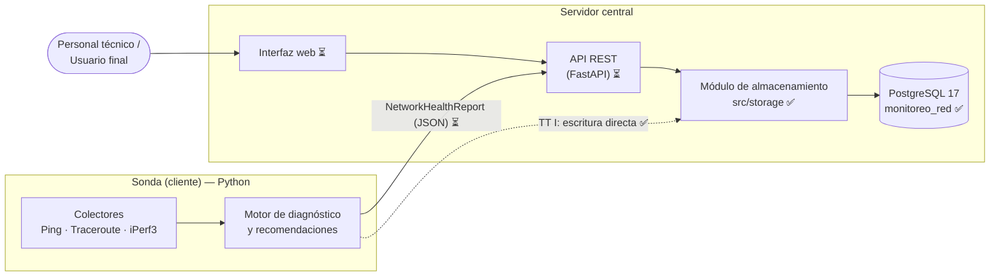
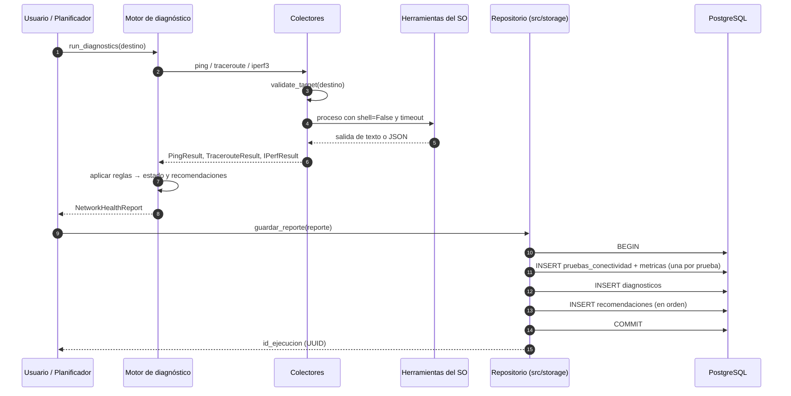
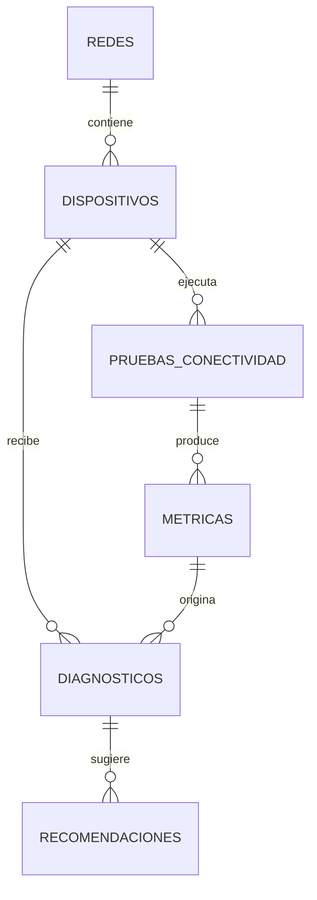

# Análisis de Requisitos y Diseño Arquitectónico

**Trabajo Terminal No. 2027-A183** — *Sistema de Monitoreo, Diagnóstico y Recomendación de Acciones Iniciales para la Evaluación de Calidad de Redes de Área Local en Entornos Académicos*

| | |
| :--- | :--- |
| **Responsable de la actividad** | Bejarano Balmori David |
| **Equipo** | Aragón Martínez Manuel Alejandro, Bejarano Balmori David |
| **Director** | M. en C. Alcaraz Torres Juan Jesús |
| **Versión** | 1.0 — octubre de 2026 |
| **Documento base** | Protocolo [TT-REESTRUC_183.md](../TT-REESTRUC_183.md) |

---

## 1. Propósito y alcance

Este documento formaliza los requisitos del sistema y la arquitectura que los satisface. Sirve como referencia
común para el desarrollo de TT I y TT II y como base del capítulo de análisis y diseño del Reporte Técnico.

**Dentro del alcance:** medición de calidad de servicio en redes LAN/WLAN académicas (latencia, jitter, pérdida
de paquetes, disponibilidad, ruta y throughput); diagnóstico preliminar basado en reglas; recomendaciones de
acciones iniciales; almacenamiento histórico; consulta de resultados por medio de una interfaz web.

**Fuera del alcance:** corrección automática de fallas, configuración de equipos de red (switches, routers,
puntos de acceso), análisis profundo de tráfico (captura de paquetes o NetFlow) y monitoreo de redes ajenas a la
institución.

---

## 2. Actores

| Actor | Descripción | Necesidad principal |
| :--- | :--- | :--- |
| **Usuario final** | Estudiante o profesor con conocimientos básicos de redes. | Saber si la red falla y qué puede hacer antes de reportarlo. |
| **Personal técnico** | Encargado de laboratorios o de la red del plantel. | Información objetiva e historial para diagnosticar con precisión. |
| **Sonda** *(actor de sistema)* | Equipo que ejecuta las pruebas de forma periódica o a solicitud. | Medir, diagnosticar y entregar los resultados para su almacenamiento. |

---

## 3. Requisitos funcionales

Estados: ✅ implementado y probado · 🟡 parcial · ⏳ pendiente (TT II).

| ID | Requisito | Objetivo | Módulo | Estado |
| :--- | :--- | :---: | :--- | :---: |
| **RF-01** | Ejecutar pruebas ICMP (ping) y obtener latencia mínima, promedio y máxima, jitter y porcentaje de pérdida. | 1 | `monitoring/ping_collector.py` | ✅ |
| **RF-02** | Trazar la ruta hacia un destino salto por salto, con la latencia y la pérdida de cada salto. | 1 | `monitoring/traceroute_collector.py` | ✅ |
| **RF-03** | Medir throughput con iPerf3 en TCP (Mbps, retransmisiones) y UDP (jitter, pérdida), con desglose por segundo. | 1 | `monitoring/iperf_collector.py` | ✅ |
| **RF-04** | Validar el destino (IPv4, IPv6 o nombre de host RFC 1123) antes de ejecutar cualquier prueba. | 1 | `monitoring/utils.py` | ✅ |
| **RF-05** | Clasificar el estado de la red como `OPTIMAL`, `DEGRADED` o `UNREACHABLE` según umbrales definidos. | 3 | `monitoring/diagnostics.py` | ✅ |
| **RF-06** | Generar recomendaciones iniciales en lenguaje claro según la anomalía detectada. | 4 | `monitoring/diagnostics.py` | ✅ |
| **RF-07** | Almacenar cada ejecución con sus pruebas, métricas, diagnóstico y recomendaciones de forma atómica. | 2 | `storage/repository.py` | ✅ |
| **RF-08** | Registrar las redes del plantel y los dispositivos (sondas) que ejecutan las pruebas. | 2 | `storage/repository.py` | ✅ |
| **RF-09** | Consultar el historial de pruebas filtrando por destino, tipo de prueba y rango de fechas. | 2 | `storage/repository.py` | ✅ |
| **RF-10** | Obtener un resumen estadístico por destino (promedios y máximos) para un periodo dado. | 2, 5 | `storage/repository.py` | ✅ |
| **RF-11** | Dar seguimiento al estado de cada recomendación (`PENDIENTE`, `APLICADA`, `DESCARTADA`). | 4 | `db/schema.sql` | 🟡 |
| **RF-12** | Ejecutar las pruebas de forma automática y periódica sobre una lista de destinos configurada. | 1 | Planificador | ⏳ |
| **RF-13** | Exponer una API REST que reciba los resultados de las sondas y sirva las consultas. | — | API (FastAPI) | ⏳ |
| **RF-14** | Mostrar en una interfaz web el estado actual, las métricas y el historial de cada destino. | 5 | Interfaz web | ⏳ |
| **RF-15** | Generar reportes descargables de un periodo para el personal técnico. | 5 | Interfaz web | ⏳ |

**Notas:**
- **RF-11** está cubierto en el modelo de datos (columna `recomendaciones.estado`), pero falta la interfaz para actualizarlo.
- **RF-12** es la diferencia entre "diagnóstico a solicitud", que ya existe, y "monitoreo", que es lo que promete el protocolo. Es prioritario para TT II.

### 3.1 Reglas de diagnóstico vigentes (RF-05 y RF-06)

| Condición | Estado | Anomalía registrada | Severidad |
| :--- | :--- | :--- | :--- |
| El destino no responde a ICMP (100 % de pérdida) | `UNREACHABLE` | `SIN_CONECTIVIDAD` | CRÍTICA |
| Pérdida de paquetes ICMP mayor a 0 % | `DEGRADED` | `PERDIDA_PAQUETES` | ALTA |
| Latencia promedio mayor a 120 ms | `DEGRADED` | `LATENCIA_ELEVADA` | MEDIA |
| Más de 50 retransmisiones TCP (iPerf3) | `DEGRADED` | `CONGESTION_TCP` | MEDIA |
| Pérdida UDP mayor a 5 % (iPerf3) | `DEGRADED` | `PERDIDA_UDP` | MEDIA |
| Ninguna de las anteriores | `OPTIMAL` | `NINGUNA` | INFO |

Los umbrales son constantes en `src/monitoring/diagnostics.py` (`LATENCIA_ELEVADA_MS`, `RETRANSMISIONES_CONGESTION`,
`PERDIDA_UDP_MAXIMA_PCT`). El módulo de almacenamiento los reutiliza para que la anomalía guardada coincida
siempre con la que generó las recomendaciones.

---

## 4. Requisitos no funcionales

| ID | Categoría | Requisito | Cómo se cumple | Estado |
| :--- | :--- | :--- | :--- | :---: |
| **RNF-01** | Portabilidad | Funcionar en Windows y Linux sin cambios de código. | Comandos y analizadores por sistema operativo; decodificación de consola en `utf-8`, `cp850` y `cp1252`. | ✅ |
| **RNF-02** | Seguridad | Impedir la inyección de comandos a través del destino. | Validación previa del destino y ejecución de procesos con `shell=False`. | ✅ |
| **RNF-03** | Seguridad | La aplicación no debe operar la base con privilegios de administrador. | Usuario `monitoreo_app` limitado a SELECT, INSERT, UPDATE y DELETE; credenciales en `.env`, excluido de Git. | ✅ |
| **RNF-04** | Confiabilidad | Una prueba fallida no debe detener el sistema. | Los colectores nunca lanzan excepciones: devuelven un `status` de error (`TIMEOUT`, `SERVER_UNREACHABLE`, `TOOL_NOT_FOUND`) y cada proceso tiene un tiempo límite. | ✅ |
| **RNF-05** | Integridad | Un reporte se guarda completo o no se guarda. | Una transacción por reporte, llaves foráneas y restricciones `CHECK` sobre los dominios. | ✅ |
| **RNF-06** | Desempeño | Las consultas de historial deben seguir siendo rápidas al crecer los datos. | Índices por fecha, por dispositivo y fecha, y por `id_ejecucion`. | ✅ |
| **RNF-07** | Trazabilidad temporal | Las fechas deben ser comparables entre sondas. | Marcas ISO 8601 en UTC y columnas `TIMESTAMPTZ`. | ✅ |
| **RNF-08** | Mantenibilidad | Cada módulo debe poder modificarse y probarse por separado. | Objetos de datos (DTOs) compartidos, capas independientes y 29 pruebas automatizadas. | ✅ |
| **RNF-09** | Usabilidad | Las recomendaciones deben entenderse sin conocimientos avanzados. | Mensajes en español con acciones concretas. La interfaz web está pendiente. | 🟡 |
| **RNF-10** | Tecnología | Python 3.10 o superior y PostgreSQL, según el protocolo. | Verificado con Python 3.14 y PostgreSQL 17. | ✅ |

### 4.1 Limitaciones conocidas

- **ICMP filtrado:** algunos destinos y routers bloquean ICMP. En ese caso un destino puede marcarse como
  inalcanzable aunque preste servicio, o el traceroute no se completa (`MAX_HOPS_EXCEEDED`).
- **iPerf3 en Windows:** no expone retransmisiones TCP ni RTT, así que la regla `CONGESTION_TCP` solo se activa
  cuando la sonda corre en Linux.
- **iPerf3 requiere servidor:** medir el throughput real exige un servidor iPerf3 en *otro* equipo de la red.
  Contra el mismo equipo (127.0.0.1) se mide la capacidad local, no la del enlace.
- **Reglas fijas:** el diagnóstico evalúa una sola ejecución y todavía no considera tendencias del historial.

---

## 5. Arquitectura

### 5.1 Estilo arquitectónico

El sistema sigue un modelo **cliente-servidor en capas**, como lo establece el protocolo:

- **Cliente (sonda):** mide la red y diagnostica de forma local. Puede haber varias sondas, por ejemplo una por laboratorio.
- **Servidor:** centraliza el almacenamiento, las consultas y la interfaz web.

Separarlos permite que las mediciones se tomen desde el punto donde el usuario percibe el problema y que el
historial de todas las sondas se consulte en un solo lugar.

**Estado actual (TT I):** la sonda usa directamente el módulo de almacenamiento (línea punteada). Por eso
mientras no exista la API, la sonda y la base deben estar en la misma red con acceso al puerto 5432.
**Objetivo (TT II):** la sonda enviará el reporte en JSON a la API, que es la única que accede a la base.
Ningún módulo cambia; solo se agrega la API entre la sonda y `src/storage`.

### 5.2 Componentes

| Capa | Componente | Ubicación | Responsabilidad |
| :--- | :--- | :--- | :--- |
| Adquisición | Utilidades seguras | `src/monitoring/utils.py` | Validar destinos, ejecutar procesos con tiempo límite y decodificar la salida. |
| Adquisición | Colectores | `src/monitoring/*_collector.py` | Ejecutar ping, tracert/traceroute e iperf3 y convertir su salida en DTOs. |
| Dominio | Modelos (DTOs) | `src/monitoring/models.py` | `PingResult`, `TracerouteResult`, `IPerfResult` y `NetworkHealthReport`, serializables a JSON. |
| Lógica | Motor de diagnóstico | `src/monitoring/diagnostics.py` | Orquestar las pruebas, aplicar las reglas y producir recomendaciones. |
| Persistencia | Mapeo | `src/storage/mapper.py` | Convertir DTOs en filas y clasificar la anomalía, sin depender de la base. |
| Persistencia | Repositorio | `src/storage/repository.py` | Guardar reportes en una transacción y ejecutar consultas de historial. |
| Persistencia | Configuración | `src/storage/config.py` | Leer los parámetros de conexión desde `.env`. |
| Datos | Esquema | `db/schema.sql` | Las 6 tablas, sus restricciones e índices. |
| Servicio ⏳ | API REST | — | Recibir reportes de las sondas y servir consultas a la interfaz web. |
| Presentación ⏳ | Interfaz web | — | Tablero de estado, historial, diagnósticos y reportes. |

### 5.3 Flujo de una ejecución

### 5.4 Modelo de datos

El modelo implementa el diagrama entidad-relación [`erd_monitoreo_red.svg`](../erd_monitoreo_red.svg) con seis
entidades. El detalle de columnas, restricciones y ajustes está en [`db/README.md`](../db/README.md).

Todas las filas de un mismo reporte comparten un `id_ejecucion` (UUID). Así se puede reconstruir una ejecución
completa (ping, traceroute, iPerf3 y su diagnóstico) con una sola consulta.

### 5.5 Decisiones de diseño

| # | Decisión | Alternativas consideradas | Justificación |
| :---: | :--- | :--- | :--- |
| D1 | Usar las herramientas nativas del sistema operativo (ping, tracert, iperf3) en lugar de sockets propios. | Scapy o sockets ICMP crudos. | No requiere privilegios de administrador, da resultados comparables a los que usa el personal técnico y funciona igual en Windows y Linux. |
| D2 | PostgreSQL como gestor de base de datos. | SQLite, MySQL. | Lo establece el protocolo; ofrece tipos de red nativos (`INET`, `CIDR`, `MACADDR`), `JSONB` y `TIMESTAMPTZ`. |
| D3 | SQL explícito con psycopg 3, sin ORM. | SQLAlchemy. | Son seis tablas y consultas conocidas; el SQL queda visible para documentarlo y optimizarlo con índices. |
| D4 | Guardar la salida completa del colector en `metricas.detalle` (JSONB). | Tablas adicionales para saltos e intervalos. | Conserva toda la información para análisis futuros sin complicar el esquema. Las columnas numéricas cubren las consultas frecuentes. |
| D5 | Separar el mapeo (`mapper.py`) del acceso a datos (`repository.py`). | Una sola clase. | La lógica de conversión se prueba sin base de datos, y la API de TT II podrá reutilizar el repositorio tal cual. |
| D6 | Diagnóstico por reglas con umbrales constantes. | Aprendizaje automático. | Las reglas son explicables para el usuario final y no requieren datos de entrenamiento. El historial almacenado permitirá ajustar los umbrales después. |
| D7 | Usuario de aplicación con permisos mínimos. | Conectarse como `postgres`. | Limita el daño ante un error o una credencial filtrada (RNF-03). |

---

## 6. Trazabilidad con los objetivos del protocolo

| Objetivo específico | Requisitos | Implementación | Evidencia |
| :--- | :--- | :--- | :--- |
| **1.** Módulo de monitoreo (latencia, pérdida, disponibilidad) | RF-01 a RF-04, RF-12 | `src/monitoring/` | Figuras 1 a 5 del [README](../README.md) |
| **2.** Almacenamiento histórico | RF-07 a RF-10 | `db/`, `src/storage/` | Figuras 7 a 10 |
| **3.** Análisis de condiciones anómalas | RF-05 | `diagnostics.py`, `mapper.py` | Figuras 6, 9 y 10 |
| **4.** Recomendaciones iniciales | RF-06, RF-11 | `diagnostics.py`, tabla `recomendaciones` | Figuras 6 y 9 |
| **5.** Interfaz web | RF-14, RF-15 | — | ⏳ TT II |
| **6.** Pruebas funcionales en escenarios controlados | Todos | `tests/` (29 pruebas) | Figuras 1 y 8; faltan escenarios de red controlados |
| **7.** Documentación técnica y manuales | — | `README.md`, `db/README.md`, este documento | Faltan el manual técnico y el de usuario |

---

## 7. Trabajo pendiente derivado

En orden de dependencia:

1. **Planificador de pruebas periódicas (RF-12):** lista de destinos e intervalo configurables, guardando cada ejecución.
2. **API REST (RF-13):** endpoints para recibir un `NetworkHealthReport` y para consultar historial, resumen y diagnósticos, usando `MonitoreoRepository`.
3. **Interfaz web (RF-14, RF-15):** tablero por destino, gráficas de latencia y pérdida en el tiempo, lista de diagnósticos con sus recomendaciones y exportación de reportes.
4. **Escenarios controlados (Objetivo 6):** pruebas entre dos equipos con iPerf3, con pérdida inducida y con un destino caído, documentando lo esperado contra lo obtenido.
5. **Manual técnico y manual de usuario (Objetivo 7).**
